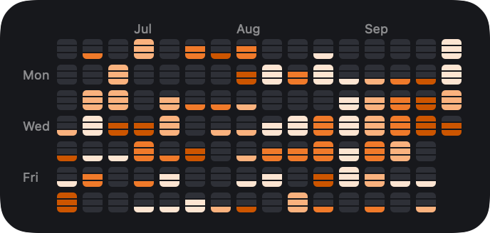

# Claude usage grid

> **This project is vibe coded.** It was written by Claude (Anthropic's AI) in Claude Code, from my spec and feedback, with me testing it on my own Mac. I didn't write the code by hand. Treat it as a personal project, not reviewed production software.

A macOS desktop widget, styled like GitHub's contribution graph, that charts your daily Claude usage. Each day is a little battery: how much of your weekly plan limit you used, filled in an orange that shows how close you came to your 5-hour limit. A menu bar app hosts it, with a full-year grid window and a view of each day's sessions and chats.



It runs entirely on your Mac, from documented sources: Claude Code's status line and hooks, one tiny `claude -p` call a day, the Agent SDK's `list_sessions()`, and your claude.ai data export. It never reads your OAuth token, keychain items or browser cookies, never calls undocumented Anthropic endpoints, and never stores chat or prompt text.

## Setup

You need macOS 26.6 or later, Python 3, Xcode with your Apple ID added (a free Personal Team is enough), Homebrew, and a Claude Pro or Max plan.

1. **Claude Code CLI.** Install it (`curl -fsSL https://claude.ai/install.sh | bash`), run `claude` once and sign in with your subscription. The daily usage reading uses it, even if you only use the desktop app.
2. **Collectors.** In this folder:

   ```bash
   make plan
   ```

   ```bash
   make install
   ```

   `make plan` shows the exact change to `~/.claude/settings.json` (a status line and two hooks) and the LaunchAgent, and writes nothing. `make install` backs up `settings.json` first, then installs everything into `~/.claude-usage-grid/`.
3. **App and widget.** `brew install xcodegen`, then `make app`. It builds, signs with your Personal Team, installs `/Applications/ClaudeUsageGrid.app` and starts it. The first time, click **Always Allow** if macOS asks about the signing key.
4. **Add the widget.** Right-click the desktop → **Edit Widgets** → search "Claude Usage Grid" → pick medium, large or extra large.
5. **Import your chats** (optional, repeat whenever you like): see [Importing your claude.ai chats](#importing-your-claudeai-chats).

The app starts at login (toggle **Launch at Login** in its menu). It lives in the menu bar; if the menu bar is too crowded to show its icon, open the app from Spotlight or Finder and the grid window appears.

## Reading the grid

Columns are weeks (oldest on the left, this week on the right), rows run Sunday to Saturday, and future days are hidden. The medium widget shows about 16 weeks; large stacks two bands (about 32 weeks); extra large shows the whole year.

**Each day is a battery.** The square is split into 3 horizontal sections that fill from the bottom. A section is ⅓ of a day's even share of your weekly limit (100% ÷ 7 ≈ 14.29% of the week).

| The day's usage, as f = usage ÷ 14.29% | The square |
|---|---|
| Before the first usage reading ever recorded | looks like an empty battery; the tooltip and day view say "no data yet" |
| f = 0 | empty battery: 3 unfilled sections |
| 0 < f ≤ ⅓ | 1 section filled |
| ⅓ < f ≤ ⅔ | 2 sections filled |
| f > ⅔ | 3 sections filled |

**The orange shows how close you came to your 5-hour limit that day**: the highest 5-hour % among that day's readings. A light, whitish orange means you stayed well under it; a deep, vivid orange means you nearly hit it.

| Peak 5-hour % that day | up to 25% | up to 50% | up to 75% | above 75% |
|---|---|---|---|---|
| Filled section color | `#FDE5D2` | `#FAB27E` | `#F07A2A` | `#CC5500` |

A day with usage but no 5-hour reading gets the lightest orange. The peak is only as good as the readings behind it; see [Known limitations](#known-limitations). To color by session count instead (Claude Code sessions plus claude.ai chats, ranked against your own history), set `"level_source": "sessions"` in the config.

Unfilled sections are `#2e3037`, and the thin dividers show the widget's background (`#17181c`). Days are 4 pt apart.

**When macOS drains the widget's color** (a window in front, or a monochrome or tinted widget style), the widget keeps its meaning through brightness alone. Filled sections are clearly brighter than unfilled ones, and brighter with more sessions. For full color even with windows in front, set System Settings → Desktop & Dock → "Dim widgets on desktop" to Never.

**Clicking a day** opens it in the app: the day's numbers, its Claude Code sessions (title, folder, times, where it ran) and its claude.ai chats. The large and extra large widgets add a header: this week's %, today's sessions, and the latest 5-hour %.

**Update Now** (top of the grid window, or ⌘U in the menu bar menu) takes a fresh usage reading, which is one tiny Claude call, and refreshes your sessions. Otherwise sessions update on their own within seconds, and usage is read automatically once a day.

The thresholds live in `aggregator/aggregator-config.json`. To override them, copy it to `~/.claude-usage-grid/aggregator-config.json` and edit the copy. `section_thresholds` sets how many sections a day has.

## How each number is computed

**Usage readings.** A reading is your plan's weekly (`seven_day`) and 5-hour (`five_hour`) usage, as a percentage. Readings come from:

- **The status line**, after each Claude Code response in the terminal. It logs a reading when either value changes, otherwise at most once a minute. The desktop app's Code tab doesn't run status lines, so if you only use the desktop app, readings come from the next two sources.
- **The daily meter.** launchd wakes `meter.py` every hour at :55, and it makes at most one automatic `claude -p` call a day: normally at 11:55 PM, but on the day your weekly limit resets, at the last :55 before the reset, so that day's pre-reset usage isn't lost. If the Mac is asleep at that moment it runs on wake that same day; a missed day is never made up after midnight, and a failed call is never retried. The call uses Haiku, no tools and a one-word reply, and is tagged so it never counts as a session.
- **Update Now**, any time. It doesn't use up the automatic run.

**A day's usage** (% of the week) is the sum of the increases of the weekly % between consecutive readings, each credited to the day of the later reading. The very first reading is only a starting point. A reset starts again from zero, so the new reading's whole value counts: the reset time moved by more than an hour, the previous window had already ended, or the % dropped by 3 or more points. Smaller drops are rounding differences between the status line and the meter and are ignored, so the same points are never counted twice and usage is never negative.

**Peak 5-hour %** is the highest 5-hour % among that day's readings. With only the daily reading it's a single sample, and the day view says how many readings it came from.

**Sessions** on a day are:

- Claude Code sessions active that day, in the terminal, VS Code or the desktop app: the hooks record each session start and each prompt, and status-line readings also mark their session. Sessions from before the hooks were installed come from `list_sessions()`, which only knows their first and last day.
- claude.ai chats with at least one message that day, from your imported export.
- A session that spans several days counts on each of them. A day with usage but no known session counts as 1.

**The orange** comes from the day's peak 5-hour %, in fixed quarters of the 5-hour limit (`five_hour_level_thresholds`: 25, 50, 75). With `"level_source": "sessions"`, it comes from session counts instead: quartiles of your days with sessions over the last 365 days, each at least one session above the previous one, and fixed buckets (1, 2–3, 4–6, 7+) until you have 14 such days. Sessions always show in tooltips, the day view and the large widget's header.

## Importing your claude.ai chats

Claude Code sessions are picked up automatically. Chats in claude.ai (or in the desktop app's Chat tab) come from Anthropic's data export:

1. On claude.ai, go to **Settings → Privacy → Export data**. The email links to a small **manifest** JSON that lists several files to download.
2. Download **`conversations-000.zip`** from it (the other files aren't needed). Each link in the manifest works only once.
3. Drop the ZIP onto the app's grid window, or click **Import claude.ai Export…** there or in the menu bar menu (⌘I). Dropping the manifest itself tells you which file to get.

Only each chat's ID, title and the days it had messages are kept, in `~/.claude-usage-grid/chats.json`. Message text is never stored: the app imports from a temporary copy of the export and deletes it right away. You can delete the downloaded ZIP afterwards; it contains your full chats. The status list shows "Chats imported through <date>". Chats after that date aren't counted until you import a newer export. Chats count toward the session numbers (tooltips, day view, the large widget's header), not the orange. Once your import is more than 7 days old (`chat_reminder_days` in `aggregator-config.json`), a small orange chat bubble appears in the widget's top-left corner, and the grid window and menu bar menu say so, with the Import button next to it. Newer exports may only cover recent chats; older chats from earlier imports are kept. Re-importing is safe: chats are updated, and chats you've since deleted on claude.ai are kept. Chats that were opened but never had a message are skipped.

In the day view, **Open in Claude** opens a chat in the desktop app and **Open in Browser** opens `https://claude.ai/chat/<id>`.

## Resuming Claude Code sessions

In the day view, **Resume in Terminal** opens a terminal in the session's folder with `/resume <id>` typed in, using the CLI's documented `claude-cli://` link; press Enter to resume. (Tested with Claude Code 2.1.285. If a future version stops accepting slash commands from links, run `claude --resume <id>` in that folder instead.) Desktop sessions also get **Open Claude**, which brings the app forward so you can pick the session in its sidebar: the desktop app has no documented link to an existing session, and it ignores slash commands that arrive through links.

Claude Code deletes transcripts after `cleanupPeriodDays` (30 by default); after that a session is still listed, but without Resume. If you want Resume to work for the whole grid, add `"cleanupPeriodDays": 365` to `~/.claude/settings.json`. Transcripts stay on your disk only, typically well under 1 GB a year.

## What's stored, and where

| Where | What |
|---|---|
| `~/.claude/settings.json` | the status line and two hooks (`SessionStart`, `UserPromptSubmit`) |
| `~/.claude-usage-grid/readings.jsonl` | usage readings: time, source, both windows' % and reset times, session ID and title for status-line readings |
| `~/.claude-usage-grid/activity.jsonl` | hook events: time, event, session ID, folder, surface (e.g. `claude-desktop`) |
| `~/.claude-usage-grid/sessions.json` | Claude Code sessions from `list_sessions()`: ID, title, folder, first and last time, whether the transcript still exists |
| `~/.claude-usage-grid/chats.json` | claude.ai chats: ID, title, days with messages |
| `~/.claude-usage-grid/meter-runs.jsonl`, `state/`, `logs/` | meter results and errors, collector state |
| `~/.claude-usage-grid/out/` | what the aggregator computes for the app |
| `~/.claude-usage-grid/bin/`, `venv/`, `backups/` | installed scripts, the Agent SDK, `settings.json` backups |
| `~/Library/Group Containers/<team>.claudeusagegrid/` | the widget's copy of the grid |
| `~/Library/LaunchAgents/local.claude-usage-grid.meter.plist` | the daily meter schedule |

Titles are your own titles or Claude's auto-generated ones; a session's first prompt (which the SDK can return as a "summary") is never read.

**Cost.** The daily meter call costs about $0.0007 (Claude Code's client-side estimate) and a sliver of your plan usage; each Update Now costs the same.

## Known limitations

- **History starts at install.** Plan usage is only known from the first reading, so earlier days look like empty batteries (with any sessions and chats listed when you hover or open them). Claude Code sessions backfill as far as transcripts exist (about 30 days by default); chats go back as far as your export.
- **Readings are sparse with the desktop app.** Usage is read when the terminal CLI responds, once a day by the meter, and when you press Update Now. A day's usage is credited to the day of the reading that observed it: if the Mac is asleep through midnight, usage from late that day lands on the next reading's day, and if it's off at reading time, that day's usage lands on the next reading's day.
- **Peak 5-hour % is sampled.** It's the highest 5-hour % among the day's readings, so with only the nightly reading it shows the 5-hour window at 11:55 PM, which may have reset hours after your busiest stretch. A busy day can then get a light orange (Oct 8, 2026: 12 points of the week used, one reading at 2%). Each Update Now adds a sample.
- **Other machines and the cloud.** Sessions on other Macs and cloud sessions aren't counted, though their usage is in the %.
- **Chats after your last import** aren't counted until the next import (the orange bubble reminds you after 7 days). There's no documented way to see claude.ai chats as they happen.
- **Undocumented fields.** The meter reads both windows from the stream's `rate_limit_event` → `unifiedWindows`, which isn't documented and may change. If it does, the status list shows "no utilization in output" and the meter needs an update.
- **Small manual resets.** A manual limit reset of less than 3 points looks like rounding noise and isn't treated as a reset.
- **Widget refreshes.** macOS may delay widget updates; the app asks for one whenever the grid changes, and the widget also asks every 30 minutes and just after midnight.
- **Free signing.** The Personal Team's development certificate expires after a year; run `make app` again to renew it.

## Troubleshooting

- **The widget shows an old look or "Open Claude Usage Grid…"**: run `make app` again. It stamps a new build number and restarts the widget. If it persists, remove the widget and add it again. The widget logs what it read: `/usr/bin/log show --last 10m --info --predicate 'subsystem == "com.petesmacintosh.ClaudeUsageGrid"'`.
- **No menu bar icon**: the menu bar may be full; open the app from Spotlight to get the grid window.
- **"Last meter run … failed: Not logged in"**: run `claude` in a terminal and `/login`.
- **Something else**: the grid window's status list shows the last reading, the last meter run, the last import and launch at login; collector errors go to `~/.claude-usage-grid/logs/errors.log`.

## Uninstalling

```bash
make uninstall-plan
```

```bash
make uninstall
```

`make uninstall-plan` shows every change and writes nothing. `make uninstall` removes the status line and hooks from `~/.claude/settings.json` (putting back a status line you had before, and keeping any other changes you've made since), the LaunchAgent, launch at login, the app and widget, and the widget's App Group folder. It keeps your data; `python3 scripts/uninstall.py apply --delete-data` deletes `~/.claude-usage-grid` too, and `--exact` restores `settings.json` byte-for-byte from the copy taken before installing. The Claude Code CLI and the PATH line in `~/.zshrc` are left alone; the plan says how to remove them.

## Development

| Path | What |
|---|---|
| `collectors/` | status line, hook, meter, session backfill, chat import (Python 3.9 stdlib, run by `/usr/bin/python3`; the backfill uses the SDK venv) |
| `aggregator/` | `aggregate.py` and `aggregator-config.json`: logs → `snapshot.json` (widget) and `details.json` (app) |
| `app/` | XcodeGen spec, the menu bar app, the widget extension, shared Swift code and Swift tests |
| `scripts/` | `install.py`, `uninstall.py`, `build_app.sh` |
| `tests/` | pytest suite |

For the tests, create the dev venv once (`python3 -m venv .venv && .venv/bin/pip install -r requirements-dev.txt`). `make test` runs the Python tests and `make app-test` the Swift tests. `ClaudeUsageGrid --render-previews <folder>` renders every widget size and the app's windows to PNGs. [PLAN.md](PLAN.md) records every design decision and why.
